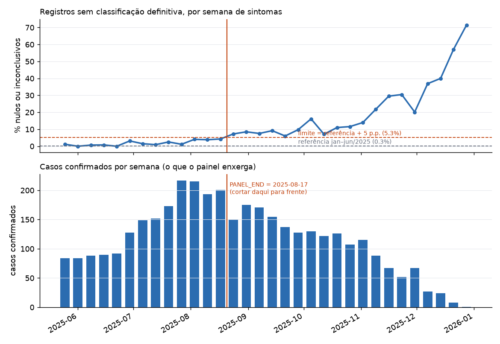

# Cauda de 2025: casos ainda sem classificação

Pendente = classificação final nula ou 8 (inconclusivo), contada sobre **todos** os registros da semana de sintomas (antes do filtro de caso confirmado).

## Critério

- Referência: fração média de pendentes em 2025-01-05 a 2025-06-29 (26 semanas): **0.27%**.
- Limite: referência + 5 pontos percentuais = **5.27%**.
- **PANEL_END = 2025-08-17**: última semana com fração dentro do limite; da semana seguinte em diante a fração fica acima do limite e não volta.

## Últimas 32 semanas

| semana (domingo) | registros | % pendentes | confirmados | no painel |
|---|---|---|---|---|
| 2025-05-25 | 172 | 1.2% | 84 | sim |
| 2025-06-01 | 143 | 0.0% | 84 | sim |
| 2025-06-08 | 149 | 0.7% | 88 | sim |
| 2025-06-15 | 132 | 0.8% | 90 | sim |
| 2025-06-22 | 134 | 0.0% | 92 | sim |
| 2025-06-29 | 193 | 3.1% | 128 | sim |
| 2025-07-06 | 202 | 1.5% | 149 | sim |
| 2025-07-13 | 217 | 0.9% | 152 | sim |
| 2025-07-20 | 239 | 2.5% | 173 | sim |
| 2025-07-27 | 262 | 1.1% | 217 | sim |
| 2025-08-03 | 295 | 4.1% | 215 | sim |
| 2025-08-10 | 286 | 3.8% | 193 | sim |
| 2025-08-17 | 305 | 4.3% | 201 | sim |
| 2025-08-24 | 276 | 7.2% | 150 | não |
| 2025-08-31 | 271 | 8.5% | 175 | não |
| 2025-09-07 | 292 | 7.5% | 171 | não |
| 2025-09-14 | 273 | 9.2% | 155 | não |
| 2025-09-21 | 232 | 6.0% | 137 | não |
| 2025-09-28 | 226 | 9.7% | 128 | não |
| 2025-10-05 | 217 | 16.1% | 130 | não |
| 2025-10-12 | 198 | 7.1% | 122 | não |
| 2025-10-19 | 209 | 11.0% | 126 | não |
| 2025-10-26 | 190 | 11.6% | 107 | não |
| 2025-11-02 | 186 | 14.0% | 115 | não |
| 2025-11-09 | 165 | 21.8% | 88 | não |
| 2025-11-16 | 132 | 29.5% | 67 | não |
| 2025-11-23 | 128 | 30.5% | 52 | não |
| 2025-11-30 | 129 | 20.2% | 67 | não |
| 2025-12-07 | 103 | 36.9% | 27 | não |
| 2025-12-14 | 70 | 40.0% | 24 | não |
| 2025-12-21 | 42 | 57.1% | 8 | não |
| 2025-12-28 | 7 | 71.4% | 1 | não |
