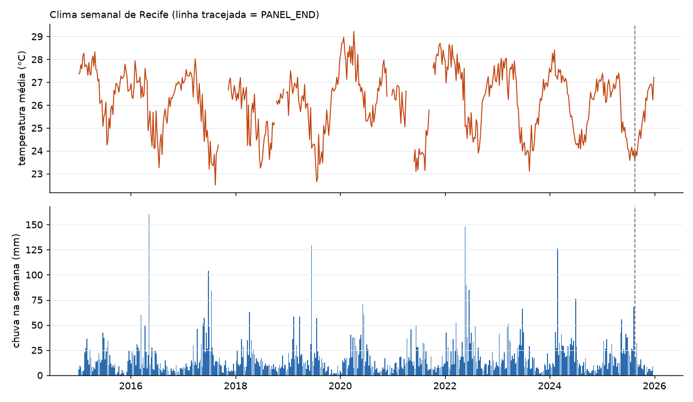

# Qualidade do clima semanal

## Fontes

- **Temperatura e umidade:** InfoDengue (`alertcity`, geocode 2611606), valores semanais do município. A resposta real da API não traz precipitação.
- **Chuva (alimenta o modelo, fonte única em todo o período 2015 até PANEL_END):** Open-Meteo Historical Weather API, modelo ERA5. **É reanálise em grade (~25 km), não medição de estação.** Precipitação diária somada por semana (domingo a sábado, dia local de Recife).
- **INMET (estação A301 de Recife):** NÃO alimenta o modelo. Usado só como verificação de sanidade nos anos em que tem dado (seção abaixo), porque não tem chuva utilizável de 2022 em diante.

## Cobertura

- Período: 2015-01-04 a 2025-12-28 (574 semanas).
- Semanas do painel (2015-01-04 a 2025-08-17): 555; sem linha no arquivo de clima: 0.
- Semanas do painel com algum valor de clima nulo: 25.

## % de nulos

| coluna | % nulos (série toda) | % nulos (semanas do painel) |
|---|---|---|
| temp_media | 4.4% | 4.5% |
| temp_min | 0.0% | 0.0% |
| temp_max | 4.4% | 4.5% |
| umid_media | 4.4% | 4.5% |
| chuva_mm | 0.2% | 0.0% |

Semanas do painel com nulos:

| week_start | temp_media | temp_min | temp_max | umid_media | chuva_mm |
|---|---|---|---|---|---|
| 2017-09-10 | — | 23.4 | — | — | 17.3 |
| 2017-09-17 | — | 23.6 | — | — | 10.7 |
| 2017-09-24 | — | 23.7 | — | — | 9.4 |
| 2017-10-01 | — | 23.9 | — | — | 3.0 |
| 2017-10-08 | — | 24.1 | — | — | 2.8 |
| 2017-10-15 | — | 24.3 | — | — | 9.9 |
| 2017-10-22 | — | 24.5 | — | — | 15.0 |
| 2017-10-29 | — | 24.6 | — | — | 7.5 |
| 2017-11-05 | — | 24.8 | — | — | 4.3 |
| 2018-10-07 | — | 24.5 | — | — | 8.3 |
| 2018-12-09 | — | 25.5 | — | — | 10.3 |
| 2018-12-16 | — | 25.4 | — | — | 10.0 |
| 2020-11-29 | — | 24.5 | — | — | 10.5 |
| 2020-12-06 | — | 24.2 | — | — | 0.4 |
| 2020-12-13 | — | 24.0 | — | — | 9.2 |
| 2020-12-20 | — | 23.7 | — | — | 2.1 |
| 2021-04-11 | — | 23.5 | — | — | 36.3 |
| 2021-04-25 | — | 22.8 | — | — | 18.1 |
| 2021-05-02 | — | 22.7 | — | — | 14.5 |
| 2021-05-09 | — | 22.5 | — | — | 45.4 |
| 2021-05-16 | — | 22.3 | — | — | 13.8 |
| 2021-05-23 | — | 22.2 | — | — | 9.7 |
| 2021-09-19 | — | 24.4 | — | — | 5.9 |
| 2021-09-26 | — | 24.8 | — | — | 19.0 |
| 2021-10-03 | — | 25.2 | — | — | 6.6 |

## Estatísticas básicas (série toda)

| coluna | média | desvio | mín | mediana | máx |
|---|---|---|---|---|---|
| temp_media | 26.1 | 1.4 | 22.5 | 26.4 | 29.2 |
| temp_min | 24.4 | 1.4 | 20.7 | 24.6 | 28.0 |
| temp_max | 28.1 | 1.6 | 23.1 | 28.0 | 31.6 |
| umid_media | 77.7 | 5.8 | 65.5 | 77.2 | 96.2 |
| chuva_mm | 17.0 | 17.6 | 0.0 | 11.8 | 160.1 |

## Verificação de sanidade da chuva (Open-Meteo x INMET A301)

Anos do INMET usados na comparação: **2015, 2016, 2017, 2018, 2019, 2020, 2021** (341 semanas, 2015-01-04 a 2021-10-31). Sem dado de chuva utilizável no INMET: 2022 e 2023 (arquivos vazios), 2024 e 2025 (estação ausente no zip). Em 2021 só entram as semanas com >= 80% das horas medidas.

| ano | semanas comparadas | Pearson | Spearman | chuva Open-Meteo / INMET |
|---|---|---|---|---|
| 2015 | 50 | 0.73 | 0.85 | 0.37 |
| 2016 | 48 | 0.75 | 0.83 | 0.51 |
| 2017 | 47 | 0.82 | 0.85 | 0.44 |
| 2018 | 49 | 0.66 | 0.64 | 0.45 |
| 2019 | 52 | 0.58 | 0.77 | 0.43 |
| 2020 | 52 | 0.82 | 0.85 | 0.49 |
| 2021 | 43 | 0.70 | 0.71 | 0.29 |
| 2022 | 0 | — | — | — |
| 2023 | 0 | — | — | — |
| 2024 | 0 | — | — | — |
| 2025 | 0 | — | — | — |
| **total** | 341 | 0.66 | 0.80 | 0.42 |

