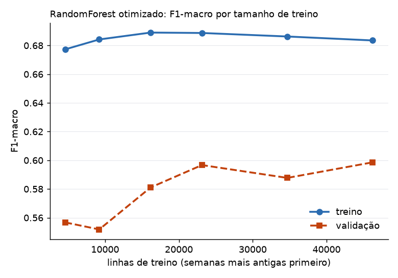

# Experimento 03: otimização de hiperparâmetros

Limiares de rótulo fixos do treino: (0, 1). **Limitação:** o RandomizedSearchCV exige um y único, então a CV usa esses limiares fixos (calculados com o treino inteiro) em todos os folds; em cada fold isso inclui alvos que seriam da validação do fold na definição das classes. Seleção: média do F1-macro nos folds 2 a 5. O conjunto de teste não foi usado.

## Ablação de features (RandomForest padrão, CV folds 2 a 5)

| fold | F1 base (21 features) | F1 base+cidade (27 features) |
|---|---|---|
| 2 | 0.601 | 0.602 |
| 3 | 0.607 | 0.623 |
| 4 | 0.607 | 0.615 |
| 5 | 0.605 | 0.610 |

- Média base: **0.605**; média base+cidade: **0.613**; diferença **+0.007**.
- Desvio entre folds (conjunto base): 0.003; desvio das diferenças pareadas: 0.006.
- Decisão: **base+cidade** (a diferença média supera o desvio entre folds).

## Busca de hiperparâmetros (n_iter = 30 por modelo)

### RandomForest (busca em 385 s)

Melhores parâmetros: `{"clf__class_weight": "balanced_subsample", "clf__max_depth": 20, "clf__max_features": "sqrt", "clf__max_samples": 0.9, "clf__min_samples_leaf": 26, "clf__min_samples_split": 26, "clf__n_estimators": 351}`

Top 5 candidatos:

| rank | f1_cv_media_f2_5 | f1_cv_desvio_f2_5 | f1_fold1 | params |
|---|---|---|---|---|
| 1 | 0.614 | 0.011 | 0.444 | {"clf__class_weight": "balanced_subsample", "clf__max_depth": 20, "clf__max_features": "sqrt", "clf__max_samples": 0.9, "clf__min_samples_leaf": 26, "clf__min_samples_split": 26, "clf__n_estimators": 351} |
| 2 | 0.613 | 0.012 | 0.446 | {"clf__class_weight": "balanced_subsample", "clf__max_depth": null, "clf__max_features": "sqrt", "clf__max_samples": null, "clf__min_samples_leaf": 27, "clf__min_samples_split": 14, "clf__n_estimators": 332} |
| 3 | 0.613 | 0.011 | 0.448 | {"clf__class_weight": "balanced", "clf__max_depth": 10, "clf__max_features": "sqrt", "clf__max_samples": 0.9, "clf__min_samples_leaf": 4, "clf__min_samples_split": 31, "clf__n_estimators": 330} |
| 4 | 0.612 | 0.013 | 0.448 | {"clf__class_weight": "balanced_subsample", "clf__max_depth": 16, "clf__max_features": 0.3, "clf__max_samples": 0.9, "clf__min_samples_leaf": 28, "clf__min_samples_split": 26, "clf__n_estimators": 330} |
| 5 | 0.612 | 0.010 | 0.441 | {"clf__class_weight": "balanced_subsample", "clf__max_depth": 10, "clf__max_features": "sqrt", "clf__max_samples": null, "clf__min_samples_leaf": 12, "clf__min_samples_split": 23, "clf__n_estimators": 352} |

### LogisticRegression (busca em 50 s)

Melhores parâmetros: `{"clf__C": 8.43101393208247, "clf__class_weight": "balanced", "clf__tol": 5.820013372709852e-05}`

Top 5 candidatos:

| rank | f1_cv_media_f2_5 | f1_cv_desvio_f2_5 | f1_fold1 | params |
|---|---|---|---|---|
| 1 | 0.601 | 0.033 | 0.447 | {"clf__C": 8.43101393208247, "clf__class_weight": "balanced", "clf__tol": 5.820013372709852e-05} |
| 2 | 0.601 | 0.033 | 0.447 | {"clf__C": 1.0907475835157696, "clf__class_weight": "balanced", "clf__tol": 7.961566078062946e-05} |
| 3 | 0.601 | 0.032 | 0.447 | {"clf__C": 7.915074397656218, "clf__class_weight": "balanced", "clf__tol": 2.0513382630874486e-05} |
| 4 | 0.601 | 0.033 | 0.447 | {"clf__C": 0.5169879442298543, "clf__class_weight": "balanced", "clf__tol": 3.913334858104374e-05} |
| 5 | 0.600 | 0.033 | 0.447 | {"clf__C": 11.015056790269638, "clf__class_weight": "balanced", "clf__tol": 1.0762979285747974e-05} |

## Escolha do modelo final

| modelo | F1 CV f2–5 | F1 validação | recall alto val | AUC macro val | F1 treino |
|---|---|---|---|---|---|
| RandomForest | 0.614 | 0.599 | 0.511 | 0.838 | 0.684 |
| LogisticRegression | 0.601 | 0.572 | 0.397 | 0.823 | 0.635 |

Persistência na validação: F1-macro 0.558, recall alto 0.533.

- RandomForest tem o maior F1-macro médio na CV (folds 2 a 5): 0.614 contra LogisticRegression 0.601.
- Na validação o F1-macro dele é 0.599 (persistência: 0.558; LogisticRegression: 0.572).
- Confirmado na validação.

## Overfitting e underfitting do modelo final

Com todo o treino: F1 treino 0.684, validação 0.599, gap 0.085. Gap moderado: algum overfitting. A validação quase não melhora nas últimas frações: mais dados do mesmo tipo ajudam pouco. Gap com a menor fração de treino: 0.121.

| fracao | semanas_treino | linhas_treino | f1_macro_treino | f1_macro_val | gap_treino_val |
|---|---|---|---|---|---|
| 0.1 | 49 | 4606 | 0.677 | 0.557 | 0.121 |
| 0.2 | 98 | 9212 | 0.684 | 0.552 | 0.132 |
| 0.35 | 172 | 16168 | 0.689 | 0.581 | 0.108 |
| 0.5 | 246 | 23124 | 0.689 | 0.597 | 0.092 |
| 0.75 | 369 | 34686 | 0.686 | 0.588 | 0.099 |
| 1.0 | 492 | 46248 | 0.684 | 0.599 | 0.085 |

