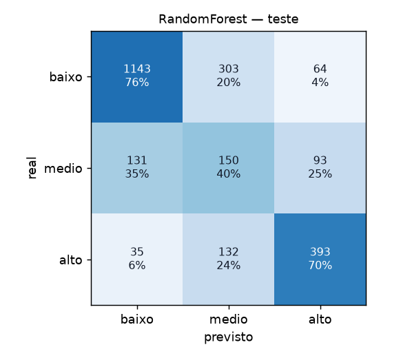
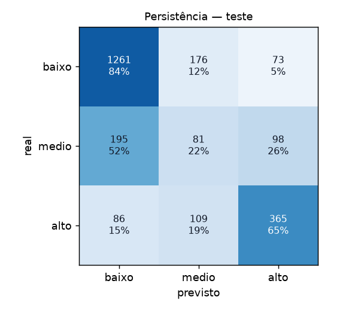
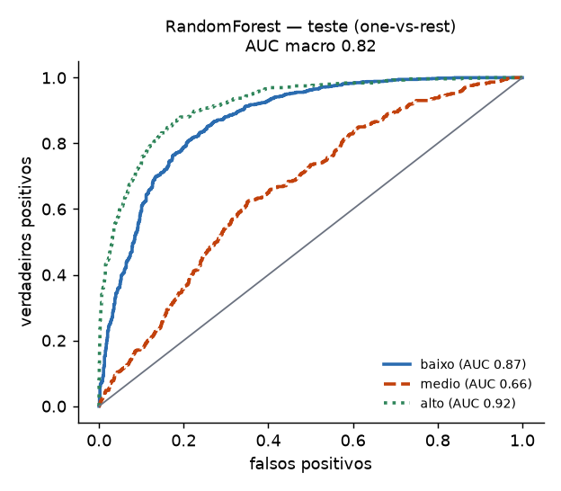

# Avaliação final no conjunto de teste

Modelo: **RandomForest** (reajustado em treino+validação; limiares do treino (0.0, 1.0)). Teste: 2025-02-16 a 2025-08-10 (26 semanas, 2444 linhas). Avaliado uma única vez.

Distribuição das classes no teste: {'baixo': 1510, 'medio': 374, 'alto': 560}

| métrica | modelo | persistência |
|---|---|---|
| F1-macro | 0.611 | 0.570 |
| balanced accuracy | 0.620 | 0.568 |
| recall alto | 0.702 | 0.652 |
| AUC macro (OvR) | 0.817 | — |

Diferença de F1-macro (modelo − persistência): **+0.040**.

## Bootstrap por blocos de semanas (1000 reamostragens)

| bloco (semanas) | dif. F1 média | IC95% dif. F1 | P(dif>0) | IC95% dif. recall alto |
|---|---|---|---|---|
| 1 | +0.040 | [+0.017, +0.061] | 1.00 | [+0.020, +0.080] |
| 2 | +0.039 | [+0.020, +0.057] | 1.00 | [+0.021, +0.081] |
| 4 | +0.037 | [+0.021, +0.054] | 1.00 | [+0.026, +0.073] |

**Conclusão:** O modelo supera a persistência de forma estatisticamente convincente: diferença de F1-macro +0.040, IC95% [+0.021, +0.054] exclui zero (bloco de 4 semanas).

  
